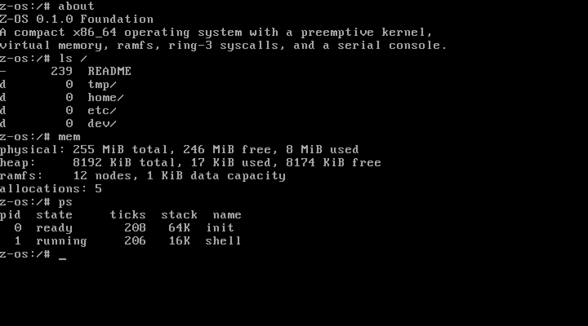

# Z-OS

Z-OS is a from-scratch, 64-bit operating system for the x86_64 PC platform.
It boots on BIOS through a two-stage loader into a freestanding C kernel and
provides a small but real protected-mode environment: preemptive kernel
threads, virtual memory, a kernel heap, a virtual filesystem backed by ramfs,
a ring-3 user program with syscalls, an interactive shell, and automated
boot-time self-tests.

This repository is an engineering foundation, not a replacement for Windows,
Linux, or macOS. It does not claim feature parity with those systems. The
implemented surface, known limitations, and a staged path toward a
general-purpose OS are documented in [docs/ROADMAP.md](docs/ROADMAP.md).

## Current status

Version 0.1.0, codename Foundation. Development quality. Not production ready.

| Area | State |
| --- | --- |
| BIOS boot | Two-stage loader, A20, E820, flat kernel load, long mode, identity map |
| CPU tables | GDT, TSS, IDT, exception diagnostics, double-fault IST stack |
| Interrupts | PIC remap, PIT at 100 Hz, PS/2 keyboard, serial RX, RTC |
| Memory | E820 physical frame bitmap, 4-level paging, 8 MiB kernel heap |
| Scheduling | Preemptive round-robin kernel threads, sleep, yield, reaping |
| Filesystem | In-memory VFS and ramfs, 128 nodes, 1 MiB maximum file size |
| User mode | Ring-3 embedded program, TSS kernel stack, `int 0x80` syscalls |
| Shell | Directory and file commands, system information, user-mode launcher |
| Verification | 43 in-kernel tests, boot smoke test, interactive shell test |

Implemented and verified:

- BIOS floppy boot with a 32-sector second stage and a fixed 320 KiB kernel slot.
- Long-mode kernel at 1 MiB with its own GDT, TSS, IDT, and page tables.
- VGA text console and 115200-baud COM1 serial mirror.
- PIT timer interrupts at 100 Hz and a preemptive round-robin scheduler.
- Physical memory manager using the E820 map, capped at the identity-mapped 1 GiB.
- Four-level virtual memory manager with 2 MiB page splitting.
- Boundary-tag kernel heap backed by scattered physical frames.
- PS/2 scan-code set 1 keyboard with shift, caps lock, control, and arrows.
- RTC date and time through CMOS.
- VFS with files, directories, rename, removal, path resolution, and devices.
- Ramfs with `/README`, `/etc`, `/home`, `/tmp`, `/dev/null`, `/dev/console`, and `/dev/random`.
- Ring-3 execution, `int 0x80`, and syscalls `write`, `exit`, `getpid`, `uptime`, and `yield`.
- Shell commands for filesystem work, diagnostics, scheduling, user mode, and power.
- ACPI PM1a shutdown path for QEMU and compatible chipsets.
- QEMU self-test image with machine-checkable pass or fail exit status.



Not implemented yet:

- SMP, APIC, ACPI table parsing, and per-CPU scheduling.
- Per-process address spaces, ELF loading, `fork`, `exec`, `wait`, signals, and a POSIX ABI.
- Persistent disks, block cache, journaling filesystem, permissions, and mount points.
- Networking, sockets, USB, audio, GPU acceleration, and a graphical compositor.
- Windows PE and Win32 compatibility, Linux ABI compatibility, or Mach-O support.
- NX, SMEP, SMAP, KASLR, ASLR, W^X enforcement, capabilities, and secure boot.
- Power management beyond a QEMU-compatible S5 shutdown request.

## Build

Requirements:

- Python 3.10 or newer
- NASM 2.15 or newer
- Clang with the `x86_64-none-elf` target
- LLD
- GNU objcopy
- QEMU for running and testing

Ubuntu and Debian:

```bash
sudo apt update
sudo apt install nasm clang lld qemu-system-x86 python3
```

Windows: the build script auto-detects an installed NASM, the Clang and LLD
copies shipped with Lean, GNU objcopy from MinGW, and QEMU in `D:\QEMU`.
Set `PATH` normally if the tools are installed elsewhere.

Build both the normal and self-test images:

```bash
python tools/build.py
```

Artifacts:

- `build/z-os.img`: normal boot image
- `build/z-os-test.img`: kernel self-test image
- `build/z-os.elf`: kernel ELF with debug symbols
- `build/manifest.json`: sizes and SHA-256 hashes

The image is a 1.44 MiB floppy image. The loader is tied to the standard
1.44 MiB geometry: 80 cylinders, 2 heads, 18 sectors per track.

## Run

QEMU with the VGA console and keyboard:

```bash
qemu-system-x86_64 -m 256M -drive format=raw,file=build/z-os.img,if=floppy -boot a
```

Windows example:

```powershell
D:\QEMU\qemu-system-x86_64.exe -m 256M -drive format=raw,file=build/z-os.img,if=floppy -boot a
```

Headless serial console:

```bash
qemu-system-x86_64 -m 256M -drive format=raw,file=build/z-os.img,if=floppy -boot a -display none -serial stdio
```

The VGA and serial consoles receive the same output. Input is accepted from
both the PS/2 keyboard and COM1.

## Test

Run the complete automated suite:

```bash
python tools/verify.py all
```

Individual checks:

```bash
python tools/verify.py test
python tools/verify.py smoke
python tools/verify.py keyboard
python tools/verify.py shell
```

The self-test image runs 43 in-kernel checks covering physical memory,
paging, the heap, the VFS, formatting, the RTC, timer wakeups, kernel threads,
and the ring-3 syscall round trip. It then exits QEMU through the ISA debug
exit device, so the harness can validate a machine-readable result rather
than a screenshot.

The keyboard check injects `help` through the QEMU monitor, exercising the
PS/2 controller, keyboard interrupt, scan-code translation, input queue, and
shell line editor. The interactive test boots the normal image, connects to a
TCP serial backend, runs shell commands, and verifies file creation, reads,
appends, renames, copies, metadata, hexdumps, memory, scheduling, ring-3
execution, cleanup, and ACPI shutdown.

Verified environment: QEMU 7.0.0 on Windows, 256 MiB RAM, default `pc`
machine and SeaBIOS. See [docs/VERIFICATION.md](docs/VERIFICATION.md).

## Shell

```text
z-os:/# help
z-os:/# ls /
z-os:/# cat /README
z-os:/# write /tmp/hello hello Z-OS
z-os:/# cat /tmp/hello
z-os:/# mem
z-os:/# ps
z-os:/# usertest
z-os:/# shutdown
```

The shell supports `help`, `about`, `version`, `uname`, `clear`, `echo`,
`pwd`, `cd`, `ls`, `cat`, `mkdir`, `rmdir`, `touch`, `write`, `append`,
`rm`, `mv`, `cp`, `stat`, `hexdump`, `df`, `mem`, `free`, `uptime`, `date`,
`ps`, `threads`, `sleep`, `history`, `rand`, `usertest`, `reboot`, and
`shutdown`.

Line editing supports backspace, Ctrl+C, and Ctrl+L. Arrow keys are decoded
for the shell but history navigation is not implemented yet.

## Repository layout

```text
boot/          BIOS stage 1, stage 2, and loader constants
kernel/        freestanding C and NASM kernel
  arch/        entry, GDT, IDT stubs, context switch, user transition
  cpu/         GDT, IDT, PIC, syscalls, power
  drivers/     console, serial, keyboard, input queue, PIT, RTC
  fs/          VFS and ramfs
  include/     kernel interfaces
  lib/         string and formatted output
  mm/          physical memory, paging, heap
  sched/       preemptive thread scheduler
  shell/       interactive shell
user/          embedded ring-3 demo program
tools/         build and verification automation
docs/          architecture, roadmap, verification
```

## Documentation

- [docs/ARCHITECTURE.md](docs/ARCHITECTURE.md)
- [docs/ROADMAP.md](docs/ROADMAP.md)
- [docs/VERIFICATION.md](docs/VERIFICATION.md)
- [docs/SECURITY.md](docs/SECURITY.md)

## License

MIT. See [LICENSE](LICENSE).
