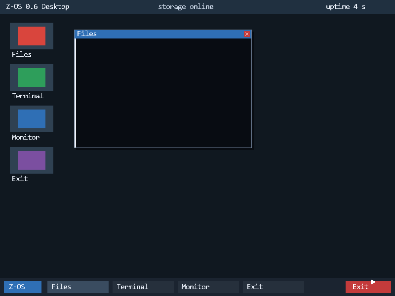

# Z-OS

Z-OS is a from-scratch, 64-bit operating system for the x86_64 PC platform.
It boots on BIOS through a two-stage loader into a freestanding C kernel and
provides a small but real protected-mode environment: preemptive kernel
threads, a preemptive user-process scheduler with per-process address spaces,
a shared kernel high-half mapping, a kernel heap, a ramfs virtual filesystem,
an ATA PIO block driver with a persistent Z-OS filesystem, a PCI e1000 network
driver with ARP, IPv4, ICMP, UDP, TCP, DHCP, cached DNS, a minimal HTTP client
and socket system calls with process ownership, POSIX style select and
non-blocking sockets, SMEP and SMAP hardware hardening, randomized heap layout,
and a C library network interface with a user-space HTTP download tool, ring-3 ELF64
processes with POSIX-style primitives, a framebuffer graphics stack with bitmap
fonts, PS/2 mouse events with an outlined graphical cursor and ghost-free
repaint, a compositor, a modern desktop environment with status bar, taskbar,
icons and draggable windows, an interactive shell, and automated boot-time
self-tests.

This repository is an engineering foundation, not a replacement for Windows,
Linux, or macOS. It does not claim feature parity with those systems. The
implemented surface, known limitations, and a staged path toward a
general-purpose OS are documented in [docs/ROADMAP.md](docs/ROADMAP.md).

## Current status

Version 1.6.0, codename Isolation. Development quality. Not production ready.

| Area | State |
| --- | --- |
| BIOS boot | Two-stage loader, A20, E820, flat kernel load, long mode, identity map |
| CPU tables | GDT, TSS, IDT, exception diagnostics, double-fault IST stack |
| Interrupts | PIC remap, PIT at 100 Hz, PS/2 keyboard, serial RX, RTC |
| Memory | E820 frame bitmap, 4-level paging, per-process PML4, shared high-half direct map |
| Processes | PID table, ready queue, isolated address spaces, descriptor tables |
| Storage | ATA PIO block device, persistent ZFS image, /disk VFS mount |
| Network | PCI e1000 driver, ARP, IPv4, ICMP, UDP, TCP, DHCP, cached DNS, HTTP GET, select, socket syscalls |
| Scheduling | Preemptive kernel threads, time-sliced user processes, timed wait queues |
| Filesystem | In-memory VFS and ramfs, 128 nodes, 1 MiB maximum file size |
| User mode | Ring-3 static ELF64 C process, TSS kernel stack, `int 0x80` syscalls |
| Graphics | PCI VGA, gfx surfaces, fonts, mouse events, compositor, desktop shell |
| Shell | Directory and file commands, system information, ELF process launcher |
| Verification | 513 in-kernel tests, boot, storage, network, tcp, internet, platform, hardening, desktop tests |

Implemented and verified:

- BIOS floppy boot with a 32-sector second stage and a fixed 320 KiB kernel slot.
- Long-mode kernel at 1 MiB with its own GDT, TSS, IDT, and page tables.
- Loader long-mode entry validated by CPUID, CR4.PAE readback, EFER.LME
  readback, and a second check inside the 64-bit kernel.
- Shared kernel high-half direct map at 0xFFFFFFFF80000000 for all processes.
- VGA text console and 115200-baud COM1 serial mirror.
- PIT timer interrupts at 100 Hz and a preemptive round-robin kernel scheduler.
- Physical memory manager using the E820 map, capped at the identity-mapped 1 GiB.
- Four-level virtual memory manager with 2 MiB page splitting and address-space objects.
- Per-process PML4 roots, user-page isolation, address-space clone, switch, and destroy.
- Boundary-tag kernel heap backed by scattered physical frames and shared supervisor mappings.
- PS/2 scan-code set 1 keyboard with shift, caps lock, control, and arrows.
- RTC date and time through CMOS.
- VFS with files, directories, rename, removal, path resolution, and devices.
- Ramfs with `/README`, `/etc`, `/home`, `/tmp`, `/dev/null`, `/dev/console`, and `/dev/random`.
- Static ELF64 loader with header, program-header, bounds, overlap, and W^X validation.
- ELF64 loading into independent process address spaces.
- Process table with PIDs, parent relationships, ready queue, exit status, and reaping.
- Preemptive time-sliced user-process scheduler with per-process kernel stacks.
- Interrupt-frame context switch on timer expiry and on blocking system calls.
- True fork continuation: the child resumes at the parent instruction after `int 0x80`.
- Blocking `wait` with syscall restart, parent wakeup, and child exit status delivery.
- Ring-3 static C programs and syscalls `write`, `exit`, `getpid`, `uptime`, `yield`, `fork`, `exec`, `wait`, `fb_info`, `fb_rect`, `fb_pixel`, and `mark`.
- Framebuffer driver: PCI VGA probe, bochs dispi mode set, VRAM mapping, and readback.
- Graphics context with clipping, rectangle fill, blitting, checksums, and frame drawing.
- Window manager with create, destroy, z-order composition, and per-window surfaces.
- User-space graphics program validated against real framebuffer pixels.
- File descriptor tables with standard descriptors, allocation, dup, close, and fork inheritance.
- POSIX credentials with uid, gid, euid, egid, permission matrices, and inheritance.
- Signal delivery with user handlers, a sigreturn trampoline, blocked masks, and pending bits.
- Blocking wait queue with timer expiry, `EAGAIN` timeouts, and `EINTR` interrupts.
- 8x16 bitmap font rendered into framebuffer and window surfaces.
- PS/2 mouse driver with packet decoding, button state, bounds clamping, and cursor save/restore.
- Compositor abstraction with layers, z-order composition, damage rectangles, and flush callbacks.
- Syscalls `open`, `close`, `read`, `dup`, `getuid`, `geteuid`, `signal`, `kill`, `sigreturn`, `sigprocmask`, `fb_text`, and `mouse`.
- Shell commands for filesystem work, diagnostics, scheduling, ELF process launch, and power.
- ACPI PM1a shutdown path for QEMU and compatible chipsets.
- QEMU self-test image with machine-checkable pass or fail exit status.




Not implemented yet:

- SMP, APIC, ACPI table parsing, and per-CPU scheduling.
- A POSIX ABI and libc, sessions, process groups, and job control.
- Demand paging, copy-on-write, swapping, and a user-space heap.
- Dynamic ELF loading, PIE relocation, shared libraries, and a user-space C library.
- Persistent disks, block cache, journaling filesystem, permissions, and mount points.
- Networking, sockets, USB, audio, GPU acceleration, and a graphical compositor.
- Windows PE and Win32 compatibility, Linux ABI compatibility, or Mach-O support.
- NX, SMEP, SMAP, KASLR, ASLR, W^X enforcement, capabilities, and secure boot.
- Power management beyond a QEMU-compatible S5 shutdown request.

## Build

Requirements:

- Python 3.10 or newer
- NASM 2.15 or newer
- Clang with the `x86_64-none-elf` target
- LLD
- GNU objcopy
- QEMU for running and testing

Ubuntu and Debian:

```bash
sudo apt update
sudo apt install nasm clang lld qemu-system-x86 python3
```

Windows: the build script auto-detects an installed NASM, the Clang and LLD
copies shipped with Lean, GNU objcopy from MinGW, and QEMU in `D:\QEMU`.
Set `PATH` normally if the tools are installed elsewhere.

Build both the normal and self-test images:

```bash
python tools/build.py
```

Artifacts:

- `build/z-os.img`: normal boot image
- `build/z-os-test.img`: kernel self-test image
- `build/z-os.elf`: kernel ELF with debug symbols
- `build/user_init.elf`, `build/user_multi.elf`, `build/user_forktest.elf`, `build/user_guitest.elf`
- `build/manifest.json`: sizes and SHA-256 hashes

The image is a 1.44 MiB floppy image. The loader is tied to the standard
1.44 MiB geometry: 80 cylinders, 2 heads, 18 sectors per track.

## Run

QEMU with the VGA console and keyboard:

```bash
qemu-system-x86_64 -m 256M -drive format=raw,file=build/z-os.img,if=floppy -boot a
```

Windows example:

```bat
D:\QEMU\qemu-system-x86_64.exe -m 256M -drive format=raw,file=build/z-os.img,if=floppy -boot a
```

Headless serial console:

```bash
qemu-system-x86_64 -m 256M -drive format=raw,file=build/z-os.img,if=floppy -boot a -display none -serial stdio
```

The VGA and serial consoles receive the same output. Input is accepted from
both the PS/2 keyboard and COM1.

## Test

Run the complete automated suite:

```bash
python tools/verify.py all
```

Individual checks:

```bash
python tools/verify.py test
python tools/verify.py smoke
python tools/verify.py bootcheck
python tools/verify.py keyboard
python tools/verify.py shell
```

The self-test image runs 513 in-kernel checks covering physical memory,
paging, the heap, the VFS, formatting, the RTC, timer wakeups, kernel threads,
ELF64 validation, per-process address spaces, high-half mapping, process
lifecycle, preemptive time slicing, fork continuation, blocking wait,
framebuffer VRAM access, gfx primitives, window composition, descriptor
tables, credentials, signal delivery, wait queues, font rendering, mouse
packets, compositor layering, POSIX user programs, and the ring-3 syscall
round trip. It then exits QEMU through the ISA debug exit device, so the
harness can validate a machine-readable result rather than a screenshot.

The boot fault check re-verifies the image stage digests against the build
manifest, boots both images with QEMU interrupt tracing, and fails on any
triple fault, page-fault exception, or VGA loader error text. It also decodes
the VGA text buffer to confirm the kernel banner and shell prompt are actually
on screen. The storage stage writes a file to the ATA disk, powers the guest off, boots
again with the same disk image, and asserts the file content is recovered. The
network stage boots with a QEMU user mode network and e1000 device, asserts
link state, MAC, address, ARP resolution of the gateway and four ICMP replies,
then forwards a UDP datagram from the host through a host forward and asserts
the guest echoes the payload back. The tcp stage boots with the same network,
resolves a domain against a controlled DNS responder, opens a TCP connection to
a host echo service, performs an HTTP request and response over TCP, and runs
the ring 3 TCP client program against a host echo service. The internet stage
requests a DHCP lease from the QEMU user mode DHCP server, proves the DNS cache
suppresses a repeated query, fetches a page body from a host HTTP server, and
verifies that sockets left open by a ring 3 process are reclaimed and their
ports are immediately reusable. The GUI stage enters the desktop, decodes a framebuffer screendump
to assert status bar, taskbar, wallpaper and icon pixels, opens a window
through the keyboard, checks the rendered title bar, types exit over the serial
console, and then verifies the shell is back in VGA text mode. The keyboard
check injects `help` through the QEMU monitor, exercising the
PS/2 controller, keyboard interrupt, scan-code translation, input queue, and
shell line editor. The interactive test boots the normal image, connects to a
TCP serial backend, runs shell commands, and verifies file creation, reads,
appends, renames, copies, metadata, hexdumps, memory, preemptive process
scheduling, fork and wait behaviour, POSIX descriptor and signal behaviour,
framebuffer graphics composition with fonts and cursor, ACPI shutdown, and
cleanup.

Verified environment: QEMU 7.0.0 on Windows, 256 MiB RAM, default `pc`
machine and SeaBIOS. See [docs/VERIFICATION.md](docs/VERIFICATION.md).

## ELF64 user programs

`user/init.c`, `user/multi.c`, `user/forktest.c`, `user/guitest.c`,
`user/postest.c`, and `user/guitest2.c` are freestanding C programs compiled
with Clang and linked by LLD at 0x40000000.
They use only the Z-OS syscall ABI and no hosted C library. Each linker output
has two PT_LOAD segments: read-execute text and read-write data with BSS. The
kernel embeds all six ELF64 images in its rodata.

The loader accepts only static `ET_EXEC` images with page-aligned,
non-overlapping PT_LOAD segments inside 0x40000000 to 0x4000FFFF. It validates
magic, class, endianness, machine, header sizes, segment bounds, address range,
page overlap, and rejects write-plus-execute segments. It does not support PIE
relocation, dynamic linking, argv, or environment strings.

## Preemptive process scheduler

`kernel/task/sched.c` runs user processes with time-slice round-robin
preemption.

- Every process owns a 16 KiB kernel stack in the shared supervisor heap.
- A synthesized interrupt frame at the top of that stack holds the user
  registers, `rip`, `cs`, `rflags`, `rsp`, and `ss` for 0x1B:0x23 Ring 3.
- `TSS.RSP0` points at the process kernel stack, so every interrupt or syscall
  from Ring 3 builds its frame there.
- The interrupt stub asks `sched_interrupt_return` after dispatch. When the
  interrupted context was Ring 3 and the quantum expired, the scheduler saves
  the frame pointer, switches CR3 and `TSS.RSP0`, and returns the next
  process frame pointer. The stub then resumes that frame with `iretq`.
- Quantum accounting runs on each 100 Hz timer tick. The default quantum is
  two ticks.
- `int 0x80` blocking calls mark the process blocked and rewind the saved
  `rip` by the 2-byte `int 0x80` instruction. When the process is woken, the
  instruction re-executes and the system call completes in the process own
  context and address space.
- `fork` copies the parent interrupt frame into a new kernel stack with
  `rax = 0`, so the child resumes at the parent instruction after the `int
  0x80` with a cloned address space.
- `exit` marks the process zombie, wakes a blocked parent, and switches to
  another ready process or returns control to the batch driver.
- A batch driver (`sched_run_batch`) is called from a kernel thread such as the
  shell. It enters user mode through an assembly helper, resumes on demand when
  no ready process remains, and reports the number of completed processes.
  Kernel-thread scheduling is suspended while a batch is active.

```text
schedtest: quantum=2 ticks completed=2 preemptions=...
schedtest: status pid 3 = 0, pid 4 = 0, result=0
```

## Fork, wait, and memory isolation

`kernel/task/process.c` maintains up to 32 process control blocks with PID,
parent PID, state, private address space, kernel stack, saved frame pointer,
CPU ticks, context switch count, quantum, wait target, and exit status.

The `forktest` program verifies three properties end to end:

- The child resumes at the parent call point; both parent and child record
  distinct process identifiers for the same code location.
- The child writes a global variable and the parent observes its own unchanged
  copy, proving that address-space cloning made a private memory copy.
- The parent blocks in `wait`, the child finishes and exits with status 42, and
  the parent only then resumes, reaps the child, and validates the status.

```text
forktest: fork child resumed at parent code point
forktest: blocking wait returned child status
forktest: parent exit status 0
```

## Graphics stack

`kernel/gui/fb.c` probes PCI for the VGA class device, reads BAR0, detects the
Bochs dispi interface, sets an 800x600x32 linear framebuffer mode, and maps VRAM
through the shared supervisor device window at 0xFFFFFFFF40000000 that every
process address space inherits from the shared high-half PDPT. The driver
supports VRAM readback tests, mode restore, and a heap-backed shadow fallback
for machines without dispi.

`kernel/gui/gfx.c` provides a surface abstraction with clipping, clear, plot,
rectangle fill, horizontal and vertical lines, rectangle frames, blitting,
checksums, and color counting. The framebuffer exposes a `gfx_surface` over
mapped VRAM.

`kernel/gui/wm.c` implements the window-manager foundation: up to eight
windows with heap-backed pixel surfaces, z-order tracking, fill and clear
operations, composition into a target surface, and destruction.

Ring-3 programs never map VRAM. They query framebuffer metadata and draw
through the `fb_info`, `fb_rect`, and `fb_pixel` system calls. `guitest` draws
a background and three colored rectangles, reads pixels back through the
kernel, and the kernel additionally verifies the real framebuffer content
after the process exits.


## POSIX primitives

`kernel/fs/fd.c` implements per-process descriptor tables. Every process starts
with descriptors 0, 1, and 2 bound to the console, then allocates file, console,
and null descriptors with read, write, and append flags. Descriptor tables are
copied on `fork`; a child closing its copy does not affect the parent.

`kernel/task/cred.c` implements uid, gid, euid, egid, a privileged flag,
owner/group/other permission checks, effective-identity changes, and credential
inheritance across fork.

`kernel/task/signal.c` implements pending and blocked signal masks, per-signal
user handlers, a user sigreturn trampoline, and frame-level delivery. When a
deliverable signal exists at the end of an interrupt or system call, the kernel
pushes a saved register frame plus the trampoline address onto the user stack,
redirects `rip` to the handler, and passes the signal number in `rdi`. The
handler returns into the trampoline, which invokes `sigreturn`; the kernel
restores the saved frame and resumes the interrupted instruction.

`kernel/task/waitq.c` implements the blocking wait queue. A parent waiting for a
child records its target PID and an optional deadline. A child exit wakes
matching waiters, and the 100 Hz timer wakes parents whose deadline expired.
`waitpid` returns `-EAGAIN` on timeout, `-EINTR` when a signal interrupts the
wait, and `-ECHILD` when no matching child exists.

Verified user-program flow (`postest`):

```text
postest: posix primitives test started
postest: fd, credentials, signals, wait verified
postest: exit status 0
```

## Fonts, mouse, and compositor

`kernel/gui/font_data.h` contains a deterministic 8x16 bitmap atlas for ASCII
32 to 126, generated from a real system font by `tools/gen_font.py` and
committed to the tree. `kernel/gui/font.c` renders glyphs and text into any
`gfx_surface`.

`kernel/gui/mouse.c` initializes the PS/2 auxiliary device, decodes three-byte
packets on IRQ12, tracks buttons and bounds, and renders a cursor with
background save/restore so the pointer can move over composed content.

`kernel/gui/compositor.c` implements the compositor abstraction: a target
surface, heap-backed layers with position and visibility, z-order composition,
damage rectangles, and an optional flush callback invoked after each present.

Ring-3 programs receive framebuffer text through the `fb_text` syscall and
mouse state through the `mouse` syscall. The `guitest2` program draws a panel
with rendered text, reads pixels back through the kernel, queries mouse state,
and the kernel verifies the real framebuffer afterwards.


## Shell

```text
z-os:/# help
z-os:/# ls /
z-os:/# cat /README
z-os:/# write /tmp/hello hello Z-OS
z-os:/# cat /tmp/hello
z-os:/# mem
z-os:/# ps
z-os:/# usertest
z-os:/# shutdown
```

The shell supports `help`, `about`, `version`, `uname`, `clear`, `echo`,
`pwd`, `cd`, `ls`, `cat`, `mkdir`, `rmdir`, `touch`, `write`, `append`,
`rm`, `mv`, `cp`, `stat`, `hexdump`, `df`, `mem`, `free`, `uptime`, `date`,
`ps`, `threads`, `sleep`, `history`, `rand`, `usertest`, `schedtest`,
`forktest`, `postest`, `guitest2`, `gfx`, `diskinfo`, `format`, `zmount`,
`zls`, `zsave`, `zcat`, `zrm`, `zsync`, `mouse`, `netinfo`, `arp`, `ping`,
`udp-echo`, `dnsserver`, `dnsport`, `dns`, `tcptest`, `tcplisten`, `nettest2`,
`dhcp`, `http`, `dnscache`, `sockinfo`, `platforminfo`, `hardening`,
`polltest`, `wget`, `gui`, `exit`, `reboot`, and `shutdown`.

`usertest` runs the ring-3 program as a scheduled process. `schedtest` runs two
processes under time slicing. `forktest` exercises fork continuation and
blocking wait. `postest` exercises descriptors, credentials, signals, and timed
wait. `guitest2` renders font text and queries the mouse. `gfx demo` enters
graphics mode and composes two windows with fonts and a cursor; `gfx test`
performs the same composition, verifies pixels, and restores text mode; `gfx
off` returns to text mode manually. `ps` reports kernel threads and process
control blocks.

Line editing supports backspace, Ctrl+C, and Ctrl+L. Arrow keys are decoded
for the shell but history navigation is not implemented yet.

## Hard disk boot and large file loading

The 1.44 MB floppy image remains the default verification target. A second
boot path boots the kernel from a 512 MB IDE disk so that large payloads can
be stored outside the kernel image.

- boot/stage1.asm writes an MBR with a 0xDA partition entry covering LBA 2048
  through the end of the disk. When the BIOS boot drive is 0x80 and INT 13h
  extensions are present, the loader reads stage2 with the disk address
  packet instead of CHS addressing. Floppy boot keeps the original path.
- boot/stage2.asm copies the kernel from a BIOS staging buffer on floppy boot.
  On disk boot it enters protected mode and reads the kernel directly from
  LBA 33 with ATA PIO, avoiding any real mode staging buffer.
- kernel/drivers/ata.c issues IDENTIFY to read the LBA48 capacity, uses the
  0x24 and 0x34 EXT commands, transfers up to 128 sectors per command and moves
  data with `rep insw` and `rep outsw`.
- kernel/fs/zdisk.c mounts the ZDISK partition, lists its directory, and loads
  a file into one contiguous physical run so the caller can read it linearly.
- tools/mkdisk.py converts assets/model.bin to FP16 and writes a 512 MB
  build/../disk/hd.img containing the partition, the directory, the weights
  and a small text file.

Build and run:

```powershell
python tools/mkdisk.py
qemu-system-x86_64 -drive format=raw,file=disk/hd.img,if=ide,index=0,media=disk -boot c -m 256M -cpu max -display none -serial stdio
```

Inside the shell:

```text
diskinfo
hdload NOTE.TXT
hdload WEIGHTS.BIN
```

`hdload` prints the byte count, elapsed milliseconds, transfer rate, the first
eight bytes of the payload, the TGPTBIN1 header fields and an FNV-1a checksum.
The reference checksum of the converted FP16 weights is b2615498d2e5f7a3 over
163828864 bytes.

## On-device TinyGPT inference

Kernel/ai contains a small transformer interpreter that runs distilgpt2 straight
out of the ZDISK partition. The loader keeps the FP16 weight block in one
contiguous physical run, so the model structure points at that block and no
copy is performed.

- kernel/ai/tgpt.c parses the TGPTBIN1 header, binds every tensor by name into
  a layer table, and runs the decoder stack with LayerNorm, multi-head attention
  with a KV cache, GELU feed forward, residual connections and a tied output
  head.
- kernel/ai/tgpt.c also implements the GPT-2 vocabulary. VOCAB.BIN stores a
  50257 entry offset table and the raw byte strings. Encoding uses longest
  match over bytes, which reproduces the official BPE ids for the test prompts.
- The ai directory is compiled with SSE enabled while the rest of the kernel
  keeps its general purpose build, because the kernel returns floats through
  vector registers.

Build the disk image and run inference:

```powershell
python tools/mkdisk.py
qemu-system-x86_64 -drive format=raw,file=disk/hd.img,if=ide,index=0,media=disk -boot c -m 256M -cpu max -display none -serial stdio
```

Inside the shell:

```text
gpt 8 The future of artificial intelligence is
```

The command loads WEIGHTS.BIN and VOCAB.BIN from ZDISK, prints the parsed model
shape, runs greedy decoding and reports tokens, elapsed milliseconds,
milliseconds per token and the generated text.

Reference result for the prompt above is the sequence 407 1865 1598 13 198,
which decodes to " not yet clear." followed by newlines. The same sequence is
produced by the PyTorch reference implementation over the same FP16 weights.

## Inference performance work

Three optimisations were evaluated against the FP16 scalar path.

### Phase profiling

kernel/ai/tgpt.c reads the timestamp counter with rdtsc around the embedding,
the first LayerNorm, the QKV projection, the attention block, the output
projection, the feed forward block and the final logits. tgpt gpt reports the
per forward cycle counts as cyc_embed, cyc_ln1, cyc_qkv, cyc_attn, cyc_proj,
cyc_ffn, cyc_logits and cyc_total.

### INT8 quantisation

tools/mkdisk.py writes WEIGHTS.Q8 next to WEIGHTS.BIN. Every linear weight is
quantised per output row with a symmetric int8 range and a float32 scale vector
stored as a separate NAME.q8scale tensor. The kernel quantises each activation
vector on the fly and accumulates int32 dot products, then rescales with the row
scale and the activation scale recorded at the start of the command.

The output head and the token embedding are deliberately left in FP16. Quantising
the tied embedding matrix perturbs the argmax and changes the generated tokens,
so the head keeps the FP16 path while the transformer body runs INT8.

Verified result for gpt 8 with the reference prompt:

| Path | Tokens | Elapsed | Per token | Output |
| --- | --- | --- | --- | --- |
| FP16 scalar | 8 | 102440 ms | 12805 ms | not yet clear. |
| INT8 body | 8 | 47960 ms | 5995 ms | not yet clear. |

The INT8 path keeps the reference token sequence and roughly halves the
inference time. The disk image grows because both weight files are present.

### Loop order and cache behaviour

The scalar matrix vector kernel accumulates four partial sums per row so that
independent multiply add chains overlap, and the Q8 kernel accumulates in int32
with the scale applied once per row. K and V cache writes stay contiguous in the
embd dimension so that attention reads stream sequentially.

### Multiprocessor status

The kernel currently boots on the boot processor only. There is no APIC, no
Application Processor startup trampoline and no per core scheduler in this
tree, so heads cannot be spread across cores yet. Adding SMP requires
enumerating the APIC identifiers, issuing INIT and STARTUP IPIs, initialising a
per core GDT, TSS and stack, and extending the run queue. This is recorded as
future work rather than attempted here.

## Repository layout

```text
boot/          BIOS stage 1, stage 2, and loader constants
kernel/        freestanding C and NASM kernel
  arch/        entry, GDT, IDT stubs, thread and process context switch
  cpu/         GDT, IDT, PIC, ELF64 loader, power
  drivers/     console, serial, keyboard, input queue, PIT, RTC, display registry, ATA PIO, PCI, e1000
  fs/          VFS, ramfs, file descriptor tables, ZFS persistent filesystem
  net/         ethernet, ARP, IPv4, ICMP, UDP, TCP, DHCP, DNS, HTTP, socket layer
  task/        processes, credentials, signals, wait queue, unified task base
  include/     shared kernel interfaces and ELF definitions
  lib/         string and formatted output
  mm/          physical memory, paging, address spaces, heap
  gui/         framebuffer, graphics context, window manager, font, mouse, compositor, desktop
  sched/       preemptive kernel thread scheduler
  shell/       interactive shell
  subsys/      syscall dispatch
  task/        process control blocks, scheduler, credentials, signals, wait queue
user/          static ELF64 C user programs, shared syscall header, linker script
tools/         build, verification, and font atlas generation
docs/          architecture, roadmap, verification
```

## Documentation

- [docs/ARCHITECTURE.md](docs/ARCHITECTURE.md)
- [docs/ROADMAP.md](docs/ROADMAP.md)
- [docs/VERIFICATION.md](docs/VERIFICATION.md)
- [docs/SECURITY.md](docs/SECURITY.md)

## License

MIT. See [LICENSE](LICENSE).
