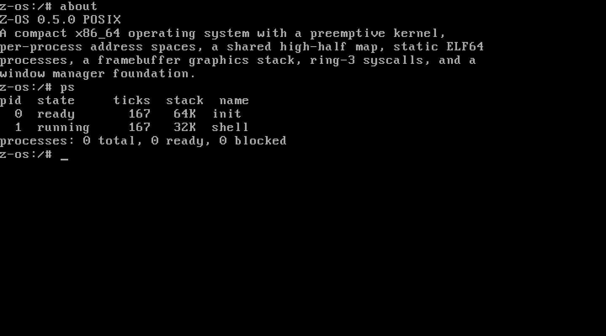
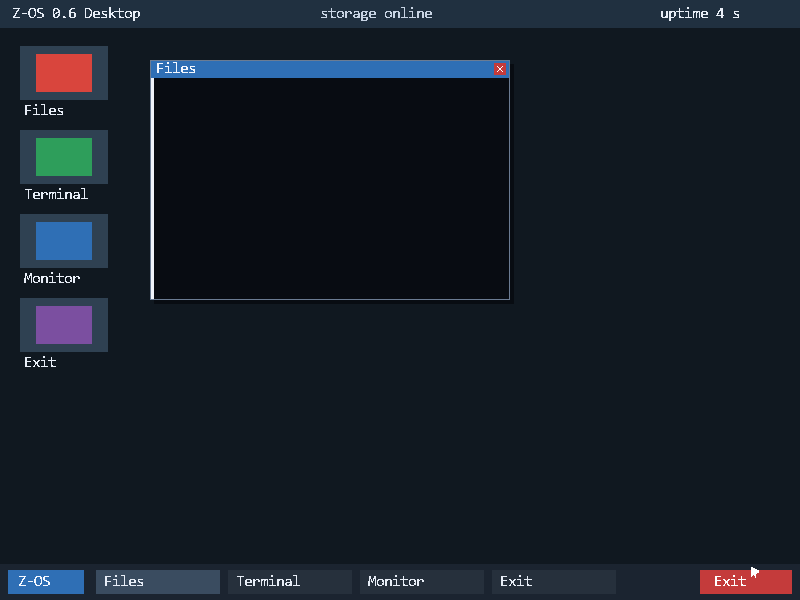

# Verification

## Environment

| Item | Value |
| --- | --- |
| Date | 2026-11-25 |
| Version | 0.7.0 Network |
| Host | Windows, x86_64 |
| Emulator | QEMU 7.0.0 |
| Machine | Default `pc`, SeaBIOS |
| Memory | 256 MiB |
| Build compiler | Clang 15.0.1, target x86_64-none-elf |
| Assembler | NASM 2.16.01 |
| Linker | LLD 15.0.1 |
| Binary conversion | GNU objcopy 2.30 |
| Automation | Python 3.11.16 |
| Guest console | VGA text and COM1 serial |

The image is booted as a 1.44 MiB floppy. No KVM acceleration is required for
the test suite.

## Commands

```bash
python tools/build.py
python tools/verify.py all
```

Individual stages:

```bash
python tools/verify.py test
python tools/verify.py smoke
python tools/verify.py bootcheck
python tools/verify.py keyboard
python tools/verify.py shell
```

## Build result

The build produces:

- `build/z-os.img`
- `build/z-os-test.img`
- `build/z-os.elf`
- `build/user_init.elf`, `build/user_multi.elf`, `build/user_forktest.elf`,
  `build/user_guitest.elf`, `build/user_postest.elf`, `build/user_guitest2.elf`,
  `build/z-os-testdisk.img`, `build/z-os-storage.img`
- `build/manifest.json`

The loader enforces a 320 KiB kernel slot. The 0.6.0 kernel occupies
approximately 183 KiB of the slot, leaving room for additional subsystems. The
image is zero-padded to 1,474,560 bytes. SHA-256 hashes for stage 1, stage 2,
the flat kernel, both images, and all six user ELF programs are written to
`build/manifest.json` after every build. The boot fault check cross-checks the
image layout against those digests.

## Self-test result

The self-test image executes 253 checks and exits QEMU through the ISA debug
exit device. A successful run returns host exit status 33, which is
`(0x10 << 1) | 1`. A failure returns 35.

Verified output ends with:

```text
ZTEST SUMMARY passed=301 failed=0
ZTEST RESULT PASS
```

The original 267 checks remain in place. This milestone adds 34 checks
covering e1000 detection, MAC and address configuration, byte order conversion,
IPv4 checksum computation and verification, IPv4 header parsing and rejection,
dotted address parsing and formatting, Ethernet frame parsing, ARP cache
insertion, lookup, removal, reply handling and request transmission, UDP
binding, duplicate rejection, datagram delivery with source information,
timeout behaviour and unbinding, socket descriptor lifecycle, ICMP echo request
answering, and receive path accounting. A further milestone added 14 checks
covering double buffer allocation, partial and full frame presentation, dirty
rectangle merging, VGA CRTC timing readback, sequencer clocking readback,
graphics controller readback, attribute controller text mode state, font plane
reload and text buffer usability after a graphics session.
covering ATA identification and sector round trips, ZFS format, mount, file
write, read, metadata reload, VFS attach and removal, mouse event queue
semantics, the text-mode pointer overlay, window frames, close buttons, title
hit testing and z-order, desktop rendering, icon clicks, dragging, close
buttons, taskbar exit, and framebuffer desktop rendering with text-mode
restoration.

Test coverage by area:

| Area | Checks |
| --- | --- |
| Physical allocator | Alignment, distinct frames, free accounting, contiguous allocation |
| Kernel heap | Small and large allocations, isolation, realloc, coalescing, counters |
| Paging | Map, access, translate, unmap, unmapped state |
| VFS | Directory creation/removal, file create, write, read, append, stat, rename, remove |
| Devices | `/dev/null` write and read semantics |
| Formatting | Integers, hexadecimal, zero padding, truncation, trim |
| Time | RTC field sanity, timer progress across a sleep |
| Scheduler | Thread creation, preemptive completion, atomic counter correctness |
| ELF64 | Embedded image validation, entry and segments, bad magic, truncation, W^X rejection, address range rejection |
| Address spaces | Distinct PML4 roots, distinct user frames, cross-space invisibility, high-half identity, high-alias translation, private kernel stacks |
| Processes | Creation, PID/parent links, image replacement, exit status, reaping, table drain |
| Preemption | Quantum configuration, two-process completion, marker totals, interleaving, forced switch counters |
| Fork and wait | Child resumes at parent code point, private memory copy, parent memory integrity, blocking order, exit status |
| Framebuffer | PCI VGA probe, BAR address, VRAM read/write/readback, mode set, mode dimensions, surface exposure |
| Graphics | Rectangle fill counts, clipping, checksums, pixel readback |
| Window manager | Window creation, second window, composition, first and later window drawing, z order, destruction, composition removal, table drain |
| User graphics | Ring-3 program exit status, real framebuffer pixels after drawing |
| Display registry | Framebuffer registration, lookup, primary selection, count, unregistration |
| Descriptors | Standard descriptors, allocation, offset reads, mode rejection, close, dup, table copies, fork inheritance, independent close |
| Credentials | Root bypass, user init, owner and group grants, other denial, escalation rejection, inheritance, privileged switch |
| Signals | Empty state, handler install, sigkill rejection, raise, block, unblock, frame redirect, trampoline, counter, pending clear, sigreturn restore |
| Wait queue | Empty state, blocked registration, infinite deadline, child-exit wake, timed expiry, removal |
| Font | Blank space glyph, glyph pixels, multi-row bitmap, text width, deterministic rendering, placement difference |
| Mouse | Driver initialization, relative movement decode, button decode, cursor render, background restore, bounds clamp |
| Storage | ATA presence, sector count, sector write and readback, restore, ZFS format, mount, write, read, list, metadata reload, VFS attach, content match, remove |
| Mouse events | Queue start state, move payload, button payload, drain order, fifo order, hardware packet generation |
| Text pointer | Overlay drawn, position tracking, overlay glyph, restore, graphics-mode suppression |
| Window frames | Frame composition, title bar pixels, close button pixels, close hit test, title hit separation, window under point, raise z-order, reaping |
| Desktop | Status bar, taskbar, wallpaper, icon hit test, icon click opens window, drag start, drag motion, drag release, close button, taskbar exit |
| GUI mode | Framebuffer mode set, surface access, status bar, taskbar, wallpaper pixels, graphics mouse mode, text mode restore |
| Buffering | Double buffer surface, dirty rectangle present, untouched pixels, full present, damaged region merge |
| VGA restore | Buffer release, CRTC horizontal timing, CRTC vertical timing, sequencer clocking, graphics controller mode, attribute text mode, font plane byte, text buffer cell |
| Network | e1000 presence, guest address, MAC, byte order, IPv4 checksum, header parse and reject, address parse and format, Ethernet parse, ARP cache and replies, UDP bind and delivery, socket lifecycle, ICMP answering, receive accounting |
| Compositor | Initialize, layer add, present, draw order, z-order, flush callback, damage records, damage clear, layer removal, output refresh, drain |
| POSIX programs | postest exit status, descriptor marks, timeout mark, signal marks, failure marker, reaping |
| User graphics 2 | guitest2 exit status, font pixels in framebuffer, title bar, accent rectangle, text mode restore |
| User mode | Ring-3 C program under the process scheduler, syscall write, syscall exit, reaping |

The storage and desktop tests produce the following serial output:

```text
multi: process started
multi: process finished
forktest: fork child resumed at parent code point
forktest: blocking wait returned child status
guitest: pixel readback verified
postest: posix primitives test started
postest: fd, credentials, signals, wait verified
guitest2: extended graphics test started
guitest2: font text rendered
guitest2: mouse state reported
guitest2: compositor surface verified
ata present: yes
ata model: QEMU HARDDISK
format: zfs formatted 8192 sectors
zmount: 0 files attached under /disk
zsync: /disk written to zfs, 1 files
zfs files: 1
-       17  persist.txt
gui: desktop active
gui: opened Files
gui: exited desktop
```

The preemption test additionally verifies that the marker trace records both
process identifiers, that the trace interleaves them, that the timer
preemption counter increases, and that both processes record forced context
switches. The fork test verifies that parent and child share a code location
but not memory, and that the wait return mark appears after the child exit mark.

## Boot smoke test

The normal image is booted with no debug-exit device. The harness waits until
the serial log contains both the boot completion line and a shell prompt:

```text
Boot complete. Starting shell.
z-os:/#
```

The process is then terminated and the log is checked for panic or exception
markers. This verifies the normal image path independent of self-test mode.

## Boot fault check

The boot fault check verifies image integrity and early boot robustness:

- The image is sliced into stage 1, stage 2, and kernel regions, and each slice
  digest is compared with the digest recorded in `build/manifest.json`, which
  detects a stale or foreign image that was not produced by the current build.
- Each image is booted headless with QEMU tracing `int,cpu_reset,guest_errors`.
- Both images must print the Z-OS banner, the kernel long-mode confirmation
  line (`EFER.LME verified`), and their respective boot markers.
- The normal image must also print the boot completion line and the shell
  prompt.
- The self-test image must also print `ZTEST BEGIN`.
- The trace must contain zero `Triple fault` records and zero page-fault
  exceptions (`v=0e`).
- The VGA text buffer is read through the QEMU monitor command `xp` and decoded
  into screen text. The normal image must show the kernel banner, the long-mode
  confirmation line, and the shell prompt on screen, and neither image may show
  `PAGING ERROR` or `LONG MODE ERROR`, so a loader diagnostic cannot hide behind
  a serial-only check.

Additional manual verification performed for the long-mode entry sequence:

- Boot matrix across 128M, 256M, 512M, 1G, and 2G guest memory: shell reached,
  no loader error on screen, long-mode line present.
- Boot with `-cpu qemu64`: shell reached, no loader error.
- Negative test with `-cpu qemu32`, which lacks long mode: the loader prints
  `Z-OS STAGE2 LONG MODE ERROR 6 HALT` on screen and halts with no triple
  fault, confirming the CPUID gate and the coded diagnostic path.

This stage exists because an early paging or loader failure otherwise shows up
only as a reset loop. It is part of the `all` stage and can be run alone with
`python tools/verify.py bootcheck` or `make bootcheck`.





## PS/2 keyboard test

The harness boots the normal image with a serial log and a QEMU monitor
connection. After the shell prompt appears, it injects the keys `h`, `e`,
`l`, `p`, and Return through the monitor. The test passes when the serial log
contains the echoed `help` command and the complete command list. This covers
the PS/2 controller, IRQ1, scan-code translation, the input queue, shell line
editing, and command dispatch.

## Interactive shell test

The harness starts QEMU with a TCP serial backend, connects to it, and drives
the shell over COM1. The following commands and properties are checked:

- `help` lists the command surface.
- `mkdir /tmp/verify` creates a directory.
- `write` creates a file with text and a trailing newline.
- `cat` returns the exact text.
- `append` grows the file.
- `mv` renames the file.
- `ls` lists the renamed file.
- `cp` copies the file.
- `stat` reports the expected size of 24 bytes.
- `hexdump` shows the expected bytes and ASCII.
- `rm` and `rmdir` clean up the test tree.
- `mem` reports physical, heap, and ramfs figures.
- `df` reports filesystem figures.
- `uptime` advances.
- `ps` shows the init and shell threads.
- `rand` produces random bytes.
- `usertest` runs the ring-3 program as a scheduled process and reaps it.
- `schedtest` runs two processes under time slicing and reports quantum,
  completions, preemption count, and both exit statuses.
- `forktest` runs the fork and blocking wait program and reports the parent
  exit status.
- `gfx test` enters graphics mode, composes two windows, verifies framebuffer
  pixels, font output, and the cursor, then restores text mode.
- `diskinfo`, `format`, `zmount`, `zls`, `zcat` and `zsync` exercise ATA and
  ZFS through the shell.
- `gui` enters the desktop session and `exit` typed inside the desktop returns
  to the shell with the VGA text console restored.
- `netinfo`, `arp`, `ping` and `udp-echo` exercise the network stack, and
  `udp-echo` is reachable from the host through a QEMU UDP host forward.
- `postest` runs the POSIX descriptor, credential, signal, and timed wait
  program and reports its exit status.
- `guitest2` renders font text into the framebuffer, queries the mouse, and
  reports the number of lit font pixels.
- `cat /README` reads the boot filesystem image.
- `shutdown` issues the ACPI PM1a power request and makes QEMU exit with
  status 0.

The shell observes the scheduler and graphics lines:

```text
schedtest: quantum=2 ticks completed=2 preemptions=...
gfx: framebuffer 800x600x32 at 0xfd000000, surface vram
gfx: window manager composited 2 windows
gfx: font pixels 660, cursor rendered
gfx: composition verified
postest: fd, credentials, signals, wait verified
guitest2: program status 0, font pixels 391, framebuffer verified
```

The test fails on unexpected panic, exception, or unknown-command output.

## Console behavior notes

QEMU's `-serial stdio` backend can deliver a pasted command as a large burst.
The emulated 16550 receive FIFO holds 16 bytes, and data can be lost while the
guest is not draining it quickly enough. Human typing and the TCP-based test
harness are unaffected. The automated tests use TCP and pace command bytes to
avoid depending on host terminal buffering.

The console driver leaves interrupts enabled during output and disables only
scheduler preemption. This allows the serial interrupt to drain receive data
while text is being rendered.

## Shutdown check

`shutdown` writes an SLP_EN request to the ACPI PM1a control block at I/O port
0x604 and waits. On the verified QEMU machine, QEMU exits with status 0. The
kernel also contains fallback writes for Bochs and VirtualBox-style power
ports. There is no ACPI table parser yet, so this is not a general chipset
solution.

## Reproducing from a clean tree

```bash
rm -rf build
python tools/build.py
python tools/verify.py all
```

The build directory is created automatically. The verification command
rebuilds first unless `--skip-build` is supplied.

## What is not verified

- Physical hardware.
- SMP, APIC, or multi-core interrupt behavior.
- SMP or concurrent execution on more than one CPU. The scheduler is
  single-core round robin, one batch at a time.
- POSIX signals, credentials, sessions, or a file-descriptor table.
- Copy-on-write fork, demand paging, or a user-space heap.
- Exec path lookup, argv/envp, auxiliary vectors, or dynamic linking.
- TCP, DNS, DHCP, IPv6 and a POSIX socket ABI; the network milestone implements
  ARP, IPv4, ICMP and UDP only.
- Network isolation: QEMU user mode networking is used, so external reachability
  beyond the virtual gateway and host forward is not exercised.
- Mouse acceleration and wheel semantics; the automated GUI stage injects
  relative motion through the QEMU monitor, which reaches the guest through the
  same IRQ12 packet path as a physical mouse. QEMU sends one initial absolute
  to relative synchronization burst, so the stage flushes it with a zero move
  before measuring pointer positions.
- Damage-driven redraw, a user-space compositor client, or window resize.
- POSIX ABI conformance, libc, argv/envp, or dynamic linking.
- The kernel executing from the high-half direct map. The high-half window is
  mapped and tested, while kernel text still executes through the low identity
  window.
- Long-running stability beyond the boot tests.
- Disk persistence, networking, USB, audio, 3D acceleration, or GPU drivers.
- Windows, Linux, or macOS binary compatibility.
- Adversarial security resistance.
- Memory hotplug, CPU hotplug, suspend, or resume.
- Real NX, SMEP, SMAP, KASLR, or ASLR behavior.

Those items are tracked in [ROADMAP.md](ROADMAP.md) and are not implied by a
passing 0.7.0 test run.
